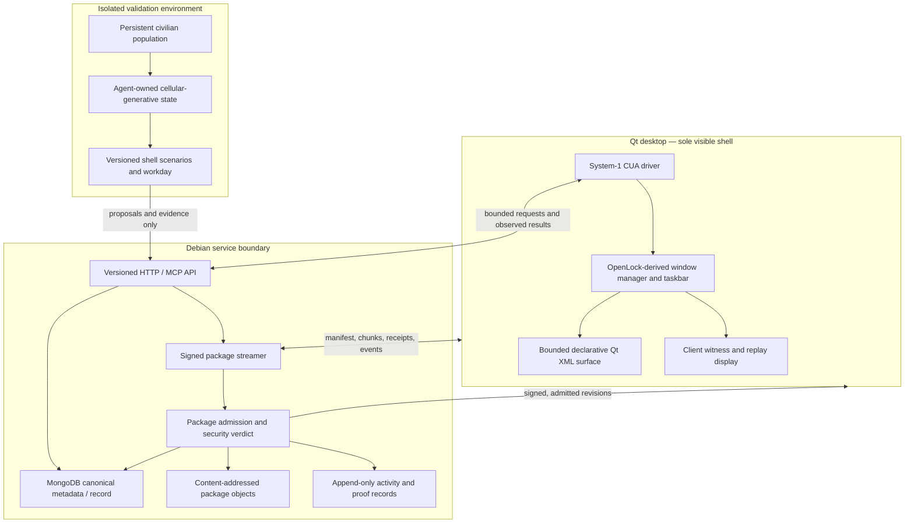

<!-- Planning artifact; source snapshot: GitHub main branches inspected 2026-11-04. No repository was modified and no implementation test is claimed. -->

# Secure Shell v2 — proposed system architecture

**Status:** Proposed architecture derived from the current Secure Shell audit, SWF cell-runtime records through 2026-11-04, OpenLock, the civilian prototype, and the supplied Genie 4 transcript. This is not yet an accepted owner ruling or an implemented design. The 20 owner decisions in `SECURE-SHELL-V2-IMPLEMENTATION-PLAN.md` remain open until answered.

**Target:** A Debian-hosted package/store service and a streamed Qt desktop client whose first usable shell window is generated from OpenLock and delivered from the Debian store. An Axis-governed System-1 CUA driver operates and verifies shell lifecycle tasks. Civilians provide long-horizon lived verification; they do not become the shell's authority or storage layer.

## 1. Design intent

Secure Shell v2 should make the server, package, window, agent, and evidence lifecycles one verifiable system without collapsing their authority boundaries.

1. **Debian server as service and package origin.** It owns the package catalogue, immutable package objects, revision admission, server-side security decisions, activity records, and stream. It does not render the desktop.
2. **Qt client as the visible shell.** The client owns windows, focus, input, layout, accessibility, and client-side witness. The exact Qt XML implementation (Qt Widgets with XML, Qt Quick/QML, or another Qt XML layer) is an open user decision.
3. **OpenLock as the first-generation shell source.** Generate from actual OpenLock shell sources, declarations, and generators; do not recreate it from screenshots or a loose visual imitation.
4. **Axis governs; System-1 CUA operates.** The CUA driver uses a bounded action catalogue and executes through the real client. Axis is the independent authorization/evidence boundary. Training, confidence, and prior success never grant new permissions.
5. **Civilians live through verification.** The civilian lived-verification star exercises persistent identities, cadence, work, learning, social coordination, learning trees, organisations, and courts. It validates continuity and institutional emergence rather than disposable demonstrations.

## 2. Proposed component map

This is a logical ownership diagram, not a claim that each component exists or that every arrow is a selected wire contract.

## 3. Ownership boundaries

| Responsibility | Owner | Must not be delegated to |
|---|---|---|
| Package schema, reader, writer, version compatibility | One recorded format owner | A second client parser, CUA guesswork, convenience adapter that becomes another format |
| Package bytes and immutable revisions | Debian store/object layer | Client cache or generated working directory as canonical record |
| Signer keys and trust-root policy | Separate server-side signing authority / protected key service | Desktop renderer, CUA agent, civilian, package itself |
| Admission verdict | Server verifier and policy owner | UI, model output, screenshot, self-declared tier |
| Window rendering and input | Qt client | Debian server, imported XML, SWF importer |
| UI description | Declarative package data under a strict reader | Executable script, arbitrary native code, XML callback into the motor |
| UI/physical operations | System-1 CUA via declared action catalogue | Direct state mutation or unrestricted tool call |
| Permission and capability evolution | Axis decision / authorized owner | Cellular automaton, trainer, CUA score, prior success |
| Civilian mind and life state | Civilian runtime, keyed by stable `AgentId` | Package store, project activity ledger, test harness |
| Project activity and artifact provenance | Server record / append-only event chain; exact MongoDB composition remains open | Civilian memory or client-side writable copy |
| Client witness | Actual Qt client over the package it displays | Headless parser, Node test, preview page, bot report alone |

Keep **package integrity**, **package identity**, **authorization**, **presentation**, and **behavioral success** distinct. A BLAKE3 digest establishes byte identity; it is not a signature. A signature is a key-backed assertion over a canonical manifest; it does not prove safety or correct rendering. Axis admission is a further step. Client evidence is further still.

## 4. Debian store and package stream

### 4.1 Store proposal

The proposed Debian deployment uses MongoDB as the canonical transactional metadata/record service, subject to the open choice of whether the current Secure Shell activity ledger is absorbed into that record or remains a chained append-only event log with MongoDB as authoritative index/transaction coordinator.

Large package payloads should be immutable content-addressed objects. MongoDB records object identity, schema, package identity, owner, signer, revision, compatibility claims, policy decisions, receipts, and lifecycle. This separates:

- **Catalogue identity:** which package and revision are requested.
- **Content identity:** BLAKE3 digest of exact canonical bytes.
- **Authority:** who signed or approved the manifest.
- **Admission:** whether server policy accepts the package.
- **Delivery:** which chunks the client received and acknowledged.
- **Mount:** what revision the client actually adopted.
- **Witness:** what the client rendered and verified.

Do not copy `openlock_axis` as the production database: the Secure Shell audit describes it as a local development comparison store, unauthenticated and without encryption at rest. Also do not assume a MongoDB implementation already exists: current Secure Shell explicitly has no MongoDB driver/dependency.

### 4.2 Signed stream proposal

The stream transports canonical package bytes; it does not become a second content grammar. A manifest should carry at least:

- package identity and revision;
- exact schema/family identifier and supported major version;
- canonical serialization identifier;
- BLAKE3 digest of the complete canonical package object;
- per-chunk digest, offset, and declared total length;
- signer key identifier and signature-suite identifier;
- build/source provenance and dependency identities;
- required capabilities as declarative references, not grants;
- compatibility declarations and migration lineage;
- server admission record and intended receiver/client version.

BLAKE3 is proposed as the content digest, not as the signature algorithm. A public-key signature suite signs a domain-separated canonical manifest containing the digest, schema, package identity, revision, total length, signer identity, and policy metadata. Ed25519 is a candidate because current Secure Shell uses it for ledger checkpoints; package-signature adoption is an owner decision.

The stream needs ordered bounded chunks, authenticated resume, idempotent operation IDs, truncation detection, explicit finalization, and atomic adoption. The client retains the previous admitted revision until the new revision passes digest, signature, schema, compatibility, and client-surface checks. A partial stream is not a valid package or a successful mount.

## 5. OpenLock-derived initial shell

The first implementation unit must generate the shell from actual OpenLock source. Initial source selection should examine:

- `clientaddon/panorama/layout/openlock_shell.xml`;
- `clientaddon/panorama/scripts/openlock_shell.js`;
- `clientaddon/panorama/scripts/openlock_delivery.js`;
- OpenLock shell-data/theme generators and their source declarations;
- `openlock.manifest.json` and the landing-page addon theme.

Record exact selected and rejected files in the format/source audit. Treat source shell as an implementation, not a screenshot or a collection of CSS values. Prefer generator output over hand-edited generated files. Preserve original source and produce reproducible Qt-facing output without committing private/source-derived movie payloads.

**First streamed window:** one useful shell bootstrap/operations window, served from the Debian store. It should show the active shell identity/revision, store and stream health, package admission state, client version, and visible test/refusal events. Its exact name and relationship to the existing Axis lane require an owner decision. The Axis lane remains content in the desktop content region; it must not become a second floating window merely to make it prominent.

Sequence: generate from OpenLock → baseline → build declared package → upload/admit into Debian store → stream manifest and bytes → verify/adopt in Qt client → render in real shell → execute a client-side check → write witness and activity record. Do not start a second window until this first one passes.

## 6. Qt XML desktop boundary

The requested Qt XML desktop is a target, not a feature already implemented in the SWF project. Its ticket 0041 describes a minimal XML client and explicitly distinguishes it from the Qt reader, which belongs to Secure Shell v2 and is not implemented there.

XML is declarative and bounded. A schema must specify supported elements, attributes, style tokens, layout, data bindings, and action-request shapes. Enforce byte count, depth, element count, attribute count, string size, asset size, and render-time budgets. Unknown or duplicate fields are refused by name. No embedded JavaScript, arbitrary stylesheet execution, native plugin loading, shell commands, or direct motor calls.

A rendered control may request an operation through the declared CUA API; XML cannot confer a capability, select an unbounded target, change persistent mind state, issue a signature, or certify its own package. One owning XML reader and one desktop renderer only.

## 7. Axis CUA and recovery

The System-1 CUA driver follows:

`observe → classify → plan → ticket → Axis gate → act → observe postcondition → verify → record → learn within scope`.

Each operation carries stable actor identity, session identity, operation ID, sequence/revision expectation, ticket, presenter, action ID, bounded arguments, expiration, and typed acknowledgement/result. Stale revisions, duplicate operations, invalid scope, unsupported actions, timeouts, cancellation, and mismatched postconditions are named refusals. Continuous inputs have bounded duration and automatic release on completion, timeout, or disconnect.

Initial driver actions cover read-only shell inspection, package/version inspection, stream status, client launch/presentation, user-approved mount, health checks, backup verification, service restart within approved policy, and rollback to a previously admitted revision. The driver cannot alter trust roots, mint signer authority, widen its action catalogue, erase evidence, or silently downgrade a format.

Recovery is a state machine, not a retry loop: detect → preserve evidence → classify failure → choose allowed recovery → execute once with idempotency → verify service and client postconditions → record recovered or refused. Failed recovery cannot destroy the last known-good package or its records.

## 8. Civilian verification and the world-simulation transcript

The supplied Genie transcript is a benchmark vocabulary, not proof that a world model can be trusted. It highlights persistent scene identity, real-time response, multi-actor behavior, physical interaction, audio/visual coherence, sparse-input interpretation, and remaining failures: off-screen fabrication, inconsistency, jerky timing, poor affect, and complex interactions that do not reliably obey intended rules.

Translate those lessons into shell requirements:

- **Persistent state:** package, window, session, and civilian identities survive restart/model replacement without accidental duplication or blank resets.
- **Temporal coherence:** server, client, streamer, and civilian cadence agree on event ordering, revision sequence, and current state.
- **Causal interaction:** a click or CUA action produces an observable server/client postcondition; plausible animation is not proof.
- **Off-screen stability:** unseen content is not invented, silently deleted, or treated as verified. Reopening a window reproduces the same admitted revision/state.
- **Multi-agent coordination:** agents can ask, decline, wait, coordinate, and finish independent tasks with separate identities and authority checks.
- **Interpretability and control:** natural-language requests become typed bounded operations; user/developer can inspect, limit, replay, and refuse results.
- **Failure-aware learning:** failed action, drifted package, incomplete stream, or wrong postcondition remains failure/indeterminate; the model cannot rewrite it as success.

The civilian lived-verification star tests the shell over a real cadence: residents retain identity and memories, choose work, learn through observation/practice/mistakes/social transmission, form learning trees and organizations, and develop institutions and courts through resident activity rather than harness scripting. The civilian mind/life store remains distinct from the Secure Shell package/activity store.

## 9. Version and naming policy — proposal

Use `secure-shell` as the product namespace. New Cargo crates should be `secure-shell-<responsibility>` rather than `planet-*`. Format/API identifiers should be descriptive, namespaced, and explicitly versioned. The names below are examples only, not accepted wire tokens:

| Responsibility | Illustrative crate | Illustrative schema/API family |
|---|---|---|
| Canonical package | `secure-shell-package` | `secure-shell.package/<major>` |
| Signed stream | `secure-shell-stream` | `secure-shell.stream/<major>` |
| Desktop declaration | `secure-shell-surface` | `secure-shell.surface/<major>` |
| Qt client | `secure-shell-qt-client` | `secure-shell.qt-surface/<major>` |
| Axis CUA | `secure-shell-axis-cua` | `secure-shell.axis-cua/<major>` |
| SWF importer adapter | `secure-shell-swf-import` | Importer API independent of source format |
| Store | `secure-shell-store` | Store API independent of MongoDB server release |
| Agent API | `secure-shell-agent-api` | `secure-shell.agent-api/<major>` |

A format major changes when a reader cannot preserve meaning or enforce the previous contract. Patch/minor releases may change implementation without silently changing byte grammar. Shell release, client API, package schema, stream protocol, CUA action catalogue, and Axis rules are versioned separately in a compatibility matrix. Content hashes are not schema versions. No upgrade-by-guessing, duplicate identity for different layouts, or hidden crosswalk between token families.

## 10. Decisions required before implementation

The 20 questions in `SECURE-SHELL-V2-IMPLEMENTATION-PLAN.md` are prerequisites. In particular, implementation must not assume MongoDB ledger authority, package signature suite, whether the stream replaces or wraps `surface.mount/2`, Qt XML meaning, exact pre/post-split formats, legacy retention strategy, or workday duration.

Until the owner records the choices in `docs/DECISIONS.md`, these remain proposals.

## 11. Sources

- Secure Shell audit: https://github.com/alacripose/secure-shell/blob/main/docs/FORMAT-SOURCES-AUDIT.md
- Secure Shell architecture/decisions: https://github.com/alacripose/secure-shell/blob/main/docs/ARCHITECTURE.md and https://github.com/alacripose/secure-shell/blob/main/docs/DECISIONS.md
- OpenLock: https://github.com/alacripose/dl-openshell
- SWF decisions: https://github.com/alacripose/swf-cell-runtime/blob/main/docs/DECISIONS-PORT.md
- Civilian expectations: https://github.com/alacripose/swf-cell-runtime/blob/main/docs/cellular_generativity_axis_civilian_expectations_prototype_rechecked.md
- User-supplied transcript: `The Rapid Progress of Realtime Simulations_AI(3).txt`.
