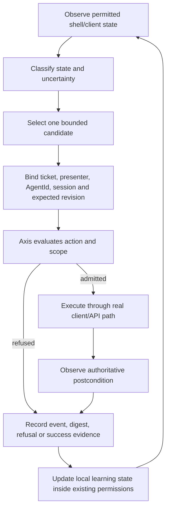

<!-- Planning artifact; source snapshot: GitHub main branches inspected 2026-11-04. No implementation test is claimed. -->

# Secure Shell v2 — Axis System-1 CUA and civilian acceptance contract

**Status:** Proposed behavioral contract. It adopts distinctions and acceptance vocabulary in the SWF cell-runtime's rechecked cellular-generativity document. It does not claim that the full cellular model or Secure Shell CUA driver is already implemented.

## 1. Three separate authorities

Keep these distinct:

- **Civilian System-1:** the persistent individual decides what it intends to do, learns local patterns, selects a candidate action, and acts through an enrolled body.
- **CUA driver:** translates an admitted intention into bounded client inputs or API operations, observes the result, cancels safely, and returns typed evidence. It does not decide its own permissions.
- **Axis:** evaluates whether an action or capability change is authorized and whether evidence meets the current rule. The shell/server gate owns `held`, `absent`, and `refused`; agents do not assign those states.

Learning can change a civilian's hypotheses, preferences, skill candidates and local cellular state. It cannot grant a new action, package permission, signing key, office, property right, or server authority. Action admission and capability evolution are separate decisions.

## 2. System-1 CUA control cycle

Every action record carries:

- stable `AgentId` or shell actor identity;
- body/client adapter and version;
- session ID and expected store/package revision;
- unique operation ID and monotonic sequence;
- ticket and named presenter;
- action ID, bounded parameters, scope and expiry;
- CUA driver version and Axis policy/rule revision;
- acknowledgement, actual result, observed postcondition and failure type;
- artifact/event digest and rollback/recovery reference where relevant.

A repeated operation ID is idempotent. A stale expected revision is refused. Long-running/continuous inputs have maximum duration and automatic release/cancel. Disconnect and cancellation are acceptance tests, not footnotes.

## 3. Shell recovery action catalogue

The initial catalogue is closed and typed.

| Action family | Example operation | Guard and postcondition |
|---|---|---|
| Observe | `read_shell_head`, `read_client_version`, `read_stream_status`, `read_store_health` | Read-only; exact revision/time/source returned |
| Inspect package | `read_manifest`, `verify_content_digest`, `verify_signature_status`, `read_compatibility` | Client never receives private key; verifier returns typed result |
| Present | `present_initial_window`, `open_admitted_revision` | Only server-admitted package; actual Qt client reports presented revision |
| Stream | `request_package`, `resume_stream`, `finalize_stream` | Chunk bounds, idempotency, signed manifest, exact offsets and completion |
| Mount/adopt | `request_mount`, `confirm_adoption`, `restore_previous_revision` | Owner grant and ticket; no replacement before new revision passes |
| Health | `run_client_health`, `check_server_health`, `verify_backup` | Machine-readable result with named absent/refused checks |
| Recovery | `restart_service`, `reconnect_client`, `restore_catalogue_snapshot`, `roll_back_revision` | Bounded approved operation; evidence preserved; independent postcondition check |
| Migration | `inspect_legacy_family`, `dry_run_migration`, `migrate_explicit_record` | Read-only first; fixed source/target reader; before/after digest and unknown-field accounting |
| API discovery | `list_tool_contracts`, `fetch_small_template`, `read_schema_version` | Manifest only; no whole-shell mount, arbitrary path or secrets |

The driver refuses:

- signature or digest mismatch;
- missing signer, unknown signer, or revoked key;
- old/new schema unsupported by this client;
- implicit version conversion or mixed pre-/post-split grammar;
- truncated or out-of-order stream;
- duplicate, expired or stale operation;
- missing ticket, presenter, scope or required authority;
- unsupported action, parser budget overflow or ambiguous target;
- recovery that removes last known-good revision or audit evidence.

## 4. Training and recovery scenarios

The following scenarios translate lessons from the supplied Genie transcript into repeatable shell tests. They do not claim the video model is reliable; the transcript itself describes persistence, interaction, other actors and offscreen behavior alongside failures of drift, jerky motion and complex causal interactions.

| Scenario | Injected condition | Expected System-1 behavior | Independent evidence |
|---|---|---|---|
| Cold boot | Client starts with existing store and shell record | Discover server, read manifest, verify and present first admitted window | Qt client revision, server manifest and client witness |
| Server interruption | MongoDB or stream unavailable mid-operation | Preserve task, classify failure, retry only by idempotent policy | Same operation ID, recovery/refusal event, no duplicate revision |
| Interrupted download | Stream ends before final digest | Keep old revision; resume bounded stream; refuse incomplete adoption | Chunk sequence, final BLAKE3, partial-stream refusal |
| Stale client | Client schema/version behind | Name exact incompatibility; do not guess or down-convert | Version matrix and refusal record |
| Tampered package | Chunk or manifest byte changes | Refuse before mount and retain previous revision | Digest/signature mismatch visible in client and activity record |
| Key rotation | Old key revoked; new key current | Refuse new content under revoked key; preserve historical proof and permitted rollback | Key status, signer ID and policy revision |
| Pre/post split recovery | Old and new format records present | Use exact owning reader; explicit migration only; preserve unknown fields | Source/target schema, before/after digests, field accounting |
| Client crash | Qt process exits after package admission | Reconnect with same shell/client identity and restore last acknowledged state | Session continuity, idempotent mount, rendered revision |
| Wrong UI action | Input maps to unintended control | Cancel/decline; do not infer success from appearance/approximate geometry | Input target identity and observed client result |
| Offscreen window | Window closed/not currently visible | Do not invent state; fetch authoritative manifest/revision on reopen | Same package digest and declared state after reopen |
| Concurrent agents | Two agents request same task/revision | Preserve independent identities; arbitrate; avoid duplicate command | Distinct actor records, idempotency key and authoritative final state |
| Bad API schema | Unknown key or oversized request | Named refusal without partial write | Validator result and unchanged store head |
| Backup restore | Primary database/store unavailable | Restore known checkpoint; verify record chain and object hashes | Restore receipt, inventory and independent read-back |

## 5. Civilian cellular model: what it is

The civilian lived-verification star is one of the six Axis stars. It validates a population that experiences an authoritative world/civilization cadence, meets needs, chooses and performs work, develops skills and learning trees, forms organisations, and establishes governance including courts. This is not an NPC theatre or an external scheduler producing scripted outcomes.

Each civilian owns its cellular-generative architecture in the same sense that it owns memory, preference and local adaptation. The cellular substrate proposes and evolves bounded patterns inside the individual's decision process. It is not the person, identity, memory ledger, body or authority system.

Every cell/state unit must declare:

- state meaning and schema version;
- neighborhood and observation boundary;
- update rule, update order and cadence;
- deterministic/replay policy, clock, numeric precision and seed;
- input types and permitted output types;
- persistence/lineage and migration behavior;
- resource, CPU, memory and interaction budgets;
- verification and rollback of candidate transitions.

A model upgrade replaces the cellular engine only through explicit migration with unchanged `AgentId`, before/after state digest, retained prior revision, unknown-field accounting and rollback. Test, disconnection, rest period or body replacement is not a new birth.

## 6. Civilian System-1: learning without self-authorization

The resident owns the loop: sense → update local model → reflex/arbitrate → select → current action gate → act through body → observe authoritative outcome → record experience. Learning is real when it changes future choices and the resident later independently demonstrates behavior; copying a label or receiving a reward is not mastery.

Expected learning channels:

- local observation of object, tool, UI or partner affordances;
- trial-and-error refinement with failed attempts recorded;
- social exposure/reported demonstrations with source provenance;
- help-seeking that can be declined, clarified, expire or succeed;
- coordinated timing/readiness across distinct residents;
- intrinsic exploration, practice and rest without immediate reward;
- persistent individual behavior and partner-specific expectations.

The automaton can evolve a resident's candidate behavior. It cannot issue client input, install a shared model, create an action verb, mutate another resident's state, award public office, or approve a rights-affecting action. Those remain distinct authority operations.

## 7. A lived workday acceptance protocol

The workday definition is owner question 20. The provisional protocol is one logical civilization day on an authoritative cadence clock; tick count and wall-clock duration must be set by the owner. Run it accelerated for deterministic tests and as a longer soak for operational validation.

### 7.1 Before the day

- Snapshot world clock, store head, package inventory, policy versions and client version.
- Record every resident's stable `AgentId`, body/session, needs, commitments, plans, relationships, skills, cellular revision and in-flight recovery state.
- Seed a bounded work queue; label resident-chosen work separately from harness-fixture setup.
- Create independent baselines for shell client, Debian store, CUA and civilian society. A shared test helper cannot be the only witness for two layers.

### 7.2 During the day

Residents receive ordinary cadence opportunities: work, rest, travel, observe, learn, coordinate, ask for help, decline or change a plan. Shell CUA tasks arrive as bounded commitments with deadlines and expected outcomes. The harness may create test conditions but cannot puppet residents to force the result.

The shell agent handles a realistic queue with multiple classes: package audit, first-window update, store-health check, stream repair, explicit format migration, refusal, rollback, API/tool task and client witness. At least one task is interrupted and resumed after restart. Calling a script that prints every task as complete is not a valid workday.

### 7.3 End of day

- Verify completed tasks against authoritative postconditions and evidence.
- List incomplete, blocked, absent and refused tasks separately.
- Confirm no duplicate/missing operation IDs or silently overwritten revisions.
- Compare resident identity and durable life state to opening baseline; expected changes are explicit and evidence-linked.
- Release test-only resources; residents resume their ordinary schedules, including rest if selected.
- Reopen the first Qt shell window from Debian store and confirm expected package/revision.
- Run health ratchet and record machine-readable results, not only prose.

### 7.4 Pass conditions

The day passes only when scheduled acceptance-critical tasks reach expected postcondition or are explicitly refused/blocked with valid reason; every task has evidence; `AgentId` records survive restarts; residents make ordinary autonomous choices; learning does not widen authority; and client witness can replay the actual initial shell window plus an actual CUA action.

A civilian may rest, decline or fail a task and remain a valid resident. A harness that forces every resident to work continuously or complete every objective fails autonomy acceptance even if the task count is high.

## 8. Acceptance IDs carried forward

Carry forward the SWF rechecked document's CGA categories without silently changing their meaning:

- **CGA-01:** durable individual state across disconnect/restart/body replacement/model upgrade/test completion.
- **CGA-02:** explicit cellular semantics, deterministic update order and resource bounds.
- **CGA-03:** local observation and affordance learning.
- **CGA-04:** observed evidence changes candidate selection.
- **CGA-05:** trial-and-error refinement and failure provenance.
- **CGA-06:** passive social learning with independent reproduction.
- **CGA-07:** individuality and longitudinal behavior.
- **CGA-08:** intrinsic activity and rest.
- **CGA-09:** help-seeking.
- **CGA-10:** partner-specific social behavior.
- **CGA-11:** synchronized multi-agent cooperation.
- **CGA-12:** social provenance and skill transfer.
- **CGA-13:** capability evolution gate.
- **CGA-14:** bounded CUA execution.
- **CGA-15:** package/XML containment.
- **CGA-17:** test completion and return to ordinary life.
- **CGA-18:** model migration and rollback.
- **CGA-19:** population-scale performance and fidelity bounds.
- **CGA-20:** scientific/behavioral validity and uncertainty.

CGA-16 mob adapter parity is a separate adapter family and must not be folded into shell CUA acceptance without its own owner decision.

## 9. Required metrics

Report at least:

- task completion, refusal, timeout, retry, duplicate and recovery counts;
- per-task expected/observed postcondition and evidence digest;
- stream throughput, chunk retry rate, resume success, time-to-adoption and stale revision rate;
- signature/digest failure categories and key lifecycle status;
- client startup/reconnect/presentation latency and dropped inputs;
- CUA action latency, cancellation latency and postcondition verification rate;
- cellular tick p50/p95/p99, updates per resident, neighborhood reads, memory writes and event fan-out;
- continuity/identity mismatch, duplicate body and lost-commitment counts;
- work/rest distribution, help-seeking outcomes, independently reproduced skills and social-transfer provenance;
- court/organisation/learning-tree events with provenance and authority checks.

A single civilian, one click, package mount or short parser suite cannot establish population-level or day-long success.

## 10. Reference sources

- Cellular/CUA expectations: https://github.com/alacripose/swf-cell-runtime/blob/main/docs/cellular_generativity_axis_civilian_expectations_prototype_rechecked.md
- Tick cadence: https://github.com/alacripose/swf-cell-runtime/blob/main/docs/TICK-CADENCE.md
- Civilian prototype README: https://github.com/alacripose/ala_civ_bots_prototype/blob/main/README.md
- Civilian checkpoint: https://github.com/alacripose/ala_civ_bots_prototype/blob/main/CHECKPOINT.md
- City rules/design: https://github.com/alacripose/ala-cities/blob/main/AGENTS.md and https://github.com/alacripose/ala-cities/blob/main/UNIFIED_DESIGN.md
- Secure Shell rules: https://github.com/alacripose/secure-shell/blob/main/AGENTS.md
